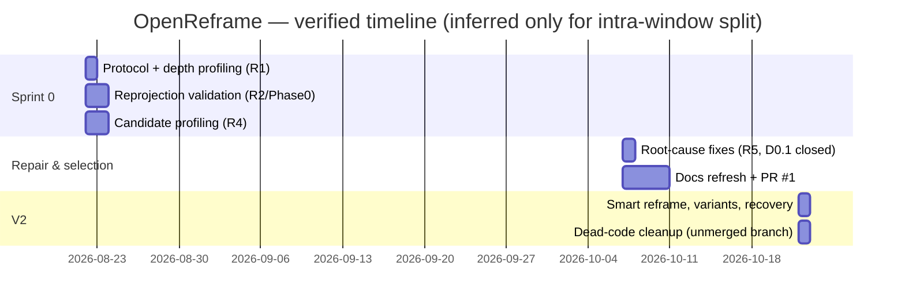
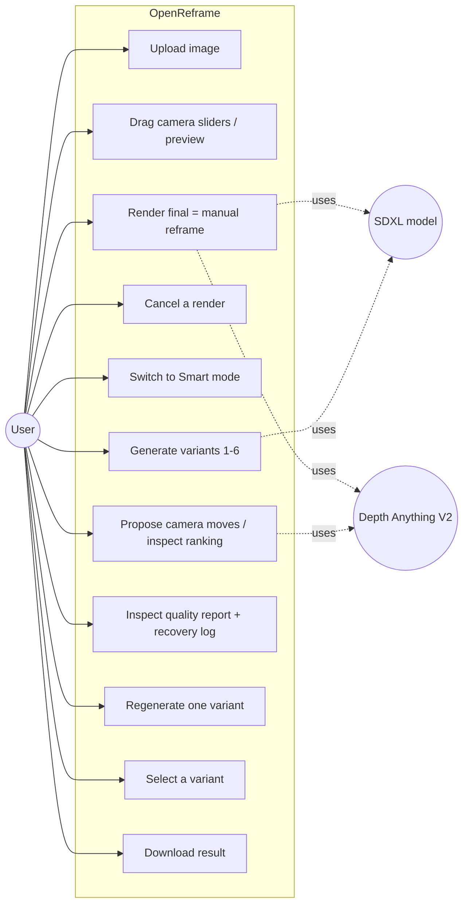
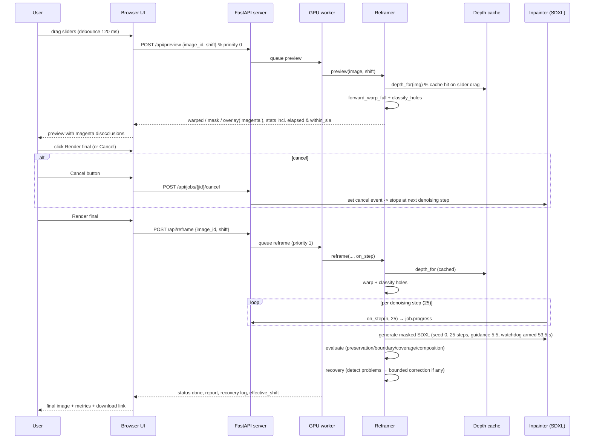

# OpenReframe — Project Report Information Pack

Source of this document: inspection of this repository (branch
`feature/v2-smart-reframing`) on 2026-10-22, including the shipped package,
the check suites, the decision/benchmark records and Git history, plus a live
re-execution of the two CPU suites and the environment check on the current
machine. **This is an information pack, not the final report.** Nothing here
replaces the student's judgement; items needing the student are collected in
the final section.

Evidence labelling used throughout:

| Tag | Meaning |
|---|---|
| **[V]** | Verified — supported by code, executed output, or an in-repo document. |
| **[I]** | Inferred — a reasonable interpretation of the implementation; not directly stated in code. |
| **[P]** | Proposed — a recommendation that has **not** been implemented. |
| **[U]** | Unavailable — cannot be determined from this repository. |

Unless the text says otherwise, "the project" means the current state of this
branch. Benchmark numbers are specific to the documented reference hardware;
they are not performance guarantees on other systems.

---

## 1. Introduction

### 1.1 Project title and purpose **[V]**

* **Title:** OpenReframe — Turning a Single Photo into a Depth-Aware View.
* **Package docstring / README:** "OpenReframe turns a single photograph into a
  gently reframed, depth-aware view. It estimates relative depth, moves the
  virtual camera, reprojects visible surfaces, and fills regions revealed
  behind objects with an inpainting model." (`README.md`,
  `openreframe/__init__.py`; version string `__version__ = "0.1.0"`).
* It is a **local-only** web application (FastAPI server + static HTML UI +
  CUDA diffusion backend), targeting a laptop GPU with **8 GB VRAM**
  (`openreframe/config.py`: `VRAM_CEIL_MB = 6.8 * 1024`, README requirements).

### 1.2 Background and motivation — concepts in plain academic language **[V for the concepts used; I for motivation framing]**

Because the report's introduction must teach the reader these terms before
using them, each is explained together with how OpenReframe actually uses it.

1. **Image reframing.** Changing how a photograph is composed — what is
   centred, how much of the scene is visible, and from what relative viewing
   position — without re-shooting the photo. OpenReframe's reframing is a
   *camera translation*: the app lets the user shift the virtual camera
   laterally (X), vertically (Y) and forward (Z), as three sliders in the UI
   (`static/index.html`, slider range ±0.25, step 0.005, labelled "units of
   median scene depth").

2. **Cropping and resizing.** Conventional tools zoom or stretch pixels in the
   original rectangle. They move no camera; the picture's parallax does not
   change — a foreground object never shifts against the background. They are
   the baseline OpenReframe deliberately moves beyond.

3. **Outpainting.** Generating pixel content *outside* the original image
   rectangle to widen it. OpenReframe does not enlarge the frame — the output
   keeps the **source aspect ratio** scaled to fit `config.CAP_PX = 1024`
   (`config.fit_resolution`); the README lists "output aspect ratio is not
   configurable" as a limitation.

4. **Inpainting.** Synthesising plausible pixel content inside a marked hole.
   OpenReframe uses diffusion inpainting (`openreframe/_inpaint.py`,
   `StableDiffusionXLInpaintPipeline`) to fill *interior* regions — the new
   parts of the frame that the camera move exposes. The same term also covers
   healing seams; the recovery logic does a small blend (`blend_seam`) across
   the mask edge.

5. **Monocular depth estimation.** Predicting a per-pixel depth (or
   disparity) map from a single RGB photo — no stereo pair, no depth sensor.
   OpenReframe uses **Depth Anything V2, ViT-Large** relative-depth
   checkpoint (`config.DEPTH_MODEL =
   "depth-anything/Depth-Anything-V2-Large-hf"`). The map is *relative*
   (disparity-like, higher = closer), not metric: there is no way to read
   metres from a raw photo, and the design avoids needing absolute scale by
   working in units of the scene's median pseudo-depth (see 1.3 and §7).

6. **Depth-aware view synthesis / reprojection.** Using the depth map and a
   target camera position to **reproject** the original pixels: each source
   pixel, treated as a 3-D point at its pseudo-depth, is projected into the
   new camera's image plane. Because pixels become sparse where surfaces
   divide (magnification stretches a pixel into many), the implementation
   uses a *forward splat* for geometry plus a *backward bilinear resample*
   for colour — a validated hybrid (`forward_warp_full` in `_warp.py`).

7. **Disocclusion.** The classic symptom of moving a camera: surfaces that
   the original camera could not see *behind* foreground objects are now
   exposed. Those regions contain **no original pixels**, so nothing can be
   warped in there — they must be *generated*. OpenReframe detects them
   analytically (holes in the splat coverage), classifies them by thickness
   versus speckle (`classify_holes`), shows them to the user in the preview as
   magenta (`render_preview_with_gaps`), and hands them to the inpainting
   model as a binary mask.

8. **Why regions "must be generated":** if the inpainter did not fill them,
   the output would contain blank/smeared placeholder pixels where the
   virtual camera revealed content that was hidden when the photo was taken.
   The exposed area is real scene content, so generating a plausible fill is
   the only way to keep the image coherent. **[I]** motivation phrasing;
   the mechanism is **[V]** in code.

### 1.3 Problem statement **[V components; I wording]**

To reframe a single photograph as if the camera had translated:

1. **Content must be preserved** — the original photo itself must remain
   unharmed where it is still visible (the project measures exactly this with
   its Original-Region Preservation SSIM metric, §8).
2. **Composition must change** — the virtual camera moves by a user-chosen
   (X, Y, forward) translation, bounded so the result stays fillable
   (`MAX_SHIFT = 0.25`; the UI rejects anything beyond it).
3. **Depth must be estimated from one image** — Depth Anything V2 ViT-L
   relative depth, converted to unitless pseudo-depth
   (`z ∝ 1/(d_norm + eps)`, percentile-clipped, anchored on the median of the
   near half; `depth_rel_to_pseudo_z` in `_warp.py`).
4. **The virtual camera movement must be simulated** — forward splat with a
   deterministic z-buffer and tie-breaking, plus backward resampling
   (`forward_warp`, `forward_warp_full`).
5. **Disoccluded regions must be detected** — coverage holes classified by
   morphological thickness per connected component with a minimum-area floor
   (`classify_holes`).
6. **Missing content must be generated** — SDXL inpainting of the mask
   (`_inpaint.py`), and evaluated afterwards by the quality metrics
   (`_quality.py`).

**Important honest claim for the report:** the system produces a
*pseudo-3D* single-image reframe — it does **not** reconstruct a complete
metrically accurate 3-D scene, and it does not claim to. There is no mesh,
no metric scale, and one depth layer per pixel (a splatted buffer, not a
multi-layer volume). Statement **[V]** from the implementation; the report
should phrase the outcome as "a reprojected, re-synthesised view", not "3-D
scene reconstruction" **[I]**.

### 1.4 Objectives (extracted from the code and records) **[V status; I wording]**

| # | Objective | Status | Evidence |
|---|---|---|---|
| O1 | Estimate relative depth from a single photo, cached per image | Completed | `DepthEstimator.pseudo_z` + content-hash cache in `_depth.py`; depth profile in `docs/benchmarks.md` `01_depth_profile` rows |
| O2 | Reproject the photo for a virtual camera translation with validated geometry | Completed | `_warp.py`; `04_reprojection_math.py` 33/33 PASS (re-ran 2026-10-22) |
| O3 | Detect disocclusion correctly (thickness-based, cleaned) | Completed | `classify_holes`; checks T10 |
| O4 | Generate disocclusion content with an inpainting model that fits an 8 GB GPU | Completed | `Inpainter` (SDXL inpaint); D0.1 selection R5 gates; candidate A p50 16.6 s / driver peak 6105 MiB (documented GPU session 2026-10-07) |
| O5 | Interactive preview of geometry before generation, inside a 2 s SLA | Completed (on GPU; CPU-only preview is supported but outside SLA) | `Reframer.preview` reports `within_sla`; documented GPU preview 510 ms; this machine's CPU round trip took 39 s (see §8) |
| O6 | Cancellable generation (between denoising steps) | Completed and demonstrated | `cancel` event + `pipe._interrupt`; documented stops at 10/25 steps (9.5 s, probe) and 6/25 (5.2 s, app path) |
| O7 | Stall/OOM survival on WDDM systems | Completed (time-based watchdog) | `_watchdog.StageWatchdog`; O5 erratum (nvidia `OutOfMemoryError` unreachable while system-memory fallback is on) |
| O8 | Smart Reframe: propose, score and rank camera movements geometrically | Completed (V2) | `_smart.py`; `/api/plan`; suite 06 S1–S6 |
| O9 | Multi-variant generation, one job per candidate | Completed (V2) | `_variants.run_variant`; `/api/variants` |
| O10 | Quality evaluation of every result | Completed (V2, measured pixel metrics; subject preservation deliberately unavailable) | `_quality.evaluate`; suite 06 Q1–Q8 |
| O11 | Bounded recovery with a recorded log, best-attempt selection | Completed (V2) | `_variants.py`; suite 06 R1–R6 |
| O12 | Local web UI with upload, preview, render, variant cards, download | Completed | `static/index.html`; live round trip 2026-10-22 (§8) |

Objectives **not** implemented (explicitly): output aspect-ratio control
**[V]** (README limitation), subject preservation (no object detector)
**[V]**, semantic failure detection **[V]**.

### 1.5 Scope and limitations **[V except where marked]**

**In scope (actual inputs/processing/outputs):**

- One JPEG/PNG photograph per upload, ≤4096 px long side (`MAX_UPLOAD_PX`);
  up to 12 images held in an in-memory LRU store (`MAX_IMAGES = 12`).
- Three manual camera-shift controls in units of median scene depth,
  geometrically clamped at `MAX_SHIFT = 0.25`.
- Pipeline: depth (cached) → forward-splat warp → hole classification →
  mask/depth downscale to the SDXL operating size → SDXL inpainting (seed 0,
  25 steps, guidance 5.5, neutral prompt) → per-metric quality report →
  bounded recovery.
- Smart mode: candidate camera movements scored from geometry only; 1–6
  variants rendered sequentially, each with its own report and recovery log;
  Select / Regenerate / Download per card.
- PNG export with a descriptive filename (`/api/result/{jid}/{kind}?download=1`).

**Known limitations (implemented statements, not guesses):**

- Depth is *relative and single-valued*: leaf scale, thin structures and
  reflections are the hardest cases. The weakest recorded result is residual
  scribbled foliage texture on `out04` (dense fine foliage against flat fog)
  **[V]**, `docs/decisions.md` R5 / AGENTS.md.
- Metrics measure *pixels*, not truth: "a confidently wrong fill scores well
  on every metric" (README). Subject preservation is reported `unavailable`.
- Inpainting can show speckle/cube/foliage artifacts under aggressive shifts;
  recovery only corrects what it can detect (§ here Risks).
- Variants run sequentially (VRAM-bounded): N variants ≈ N render times
  **[V]** README.
- No authentication, no persistence: uploads/results are in-memory and lost
  on server stop; server must not be exposed to untrusted networks
  (`README`, `docs/setup-windows.md`).
- Realistic shifts keep disocclusion at about 8.6–23.6% of the frame; more
  dramatic shifts are rejected by the quality/recovery machinery **[V]**.

---

## 2. Literature Survey / Existing System

All references below were checked against arXiv/IEEE/publisher pages this
session; the full IEEE list is in §11. Every technique named here is one the
codebase actually uses or contrasts against.

### 2.1 Techniques table

| Technique | Primary source (verified) | What it contributes to OpenReframe | Key limitation inherited |
|---|---|---|---|
| Latent diffusion / Stable Diffusion | Rombach et al., CVPR 2022, arXiv:2112.10752 | Generative base of the inpainter; inpaint pipeline denoises a masked latent | Generated content is *plausible*, not guaranteed correct; iterates 25 steps ≈ seconds of GPU work |
| SDXL + SDXL inpainting pipeline | Podell et al., ICLR 2024, arXiv:2307.01952; model card `diffusers/stable-diffusion-xl-1.0-inpainting-0.1` | The shipped backend (candidate A): best rubric quality that still fits the VRAM/latency gates | Needs ~6 GB GPU peak even with CPU offload; latency ~16–24 s/render |
| DPM-Solver++ (Karras-sigma multistep) | Lu et al., arXiv:2211.01095 | The scheduler used by every candidate (`DPMSolverMultistepScheduler`, `use_karras_sigmas=True, algorithm_type="dpmsolver++"`) | — |
| ControlNet (depth conditioning) | Zhang & Agrawala, ICCV 2023, arXiv:2302.05543 | Implemented as *optional* depth conditioning, used by research candidates B and C, **not** the shipped path (`BACKEND_CONTROLNET = None`) | Candidate C exceeded both VRAM and latency gates (documented: p95 378.7 s after spilling into system RAM) |
| Depth Anything V2 (monocular relative depth) | Yang et al., NeurIPS 2024, arXiv:2406.09414; model card ViT-L | The depth estimator; relative (disparity-like) output is sufficient under median-normalised slider units | Relative, not metric; single-layer; noisy at leaf scale (motivates bilateral smoothing) |
| Image quality from SSIM | Wang et al., IEEE TIP 2004, DOI 10.1109/TIP.2003.819861 | Original-Region Preservation metric (11×11 Gaussian window, per Wang's formulation, computed on CPU) | SSIM ≠ perceptual correctness; measured against the *reprojected* frame so camera motion does not penalise it |
| Bilateral filtering | Tomasi & Manduchi, ICCV 1998 | `smooth_relative_depth` — edge-preserving smoothing that suppresses foliage-scale depth noise before splatting | Over-smoothing can flatten genuine thin-depth detail |
| Forward splatting view synthesis | Niklaus et al., "3D Ken Burns Effect from a Single Image", ACM TOG 38(6) / SIGGRAPH Asia 2019, arXiv:1909.05483 | Conceptual ancestor of the z-buffered forward splat; OpenReframe adds a deterministic two-pass tie-break | Splat holes need classification; nearest-Colour alone produces speckle (documented in R2) |
| 3-D photo inpainting (layered) | Shih et al. (Shih, Su, Kopf, Huang), CVPR 2020, arXiv:2004.04727 | Closest classical problem framing: single photo → move camera → fill background | Multi-layer pipeline with context-aware inpainting; OpenReframe keeps a simpler splat + SDXL design for the 8 GB budget |
| Diffusion inpainting | Lugmayr et al., "RePaint", arXiv:2201.09865 (2022) | Related work for mask-aware diffusion editing | — |

### 2.2 Limitations of prior/conventional approaches (why the project exists) **[I analytical summary; V for project behaviour]**

- **Cropping/zooming:** moves no parallax; the framing change is a pure
  rectangle operation.
- **Resizing/stretching:** non-uniform scaling distorts scene geometry.
- **Basic outpainting:** enlarges the canvas but generates entirely new
  peripheral content without any geometric relationship to a moved camera.
- **Naïve depth-warp demos:** nearest-pixel splats alone → speckle/stripe
  holes; median normalisation breaks on far-field-saturated photos (this
  project measured both failure modes and fixed them — see §8 bug log).
- **Heavy web services:** typically hosted, remote, and not controllable
  locally. OpenReframe is deliberately local-first.

### 2.3 Comparison table (Approach | capability | limitation | relevance)

| Approach | Main capability | Limitations | Relevance to OpenReframe |
|---|---|---|---|
| Crop/resize/stretch | Rectangular recomposition | No parallax; distortion when stretched | Baseline the app supersedes |
| Basic outpainting (SD img2img outside canvas) | Wider canvas | No camera movement semantics | Contrasted: OpenReframe reframes *within* the source aspect ratio |
| 3D photo inpainting pipeline (Shih et al. 2020) | Full 3-D parallax animation from one photo | Heavy multi-layer machinery; needs context-aware inpainting network | Problem framing closest; OpenReframe targets an 8 GB laptop budget instead |
| 3D Ken Burns (Niklaus et al. 2019) | Viewpoint animation with depth inpainting + squeaky-wheel splatting | Designed for video trajectories; heavier pipeline | Conceptual basis of the forward-splat step |
| RePaint / diffusion inpainting methods | Mask-aware content generation | Quality limited to diffusion prior | Basis of the fill stage |
| SDXL inpaint (candidate A — shipped) | Photoreal masque fills within ~16–24 s | Severe artifacts ≥ 20% exposure feasible; needs GPU | This is the shipped backend |
| SDXL inpaint + depth-ControlNet (candidate C) | Geometry-conditioned fills | 6.9 GB+ over VRAM budget; 378.7 s p95 on the reference GPU | Eliminated on documented gates; code branch kept for re-profiling only |
| SD1.5 inpaint + depth-CN (candidate B) | Fastest (6–12 s) | Visible netting/grid on textured surfaces (documented) | Kept as a comparison candidate |

**Honesty rule for the report:** do not claim OpenReframe *outperforms*
any published system. The only documented comparison is internal — candidates
A/B/C on the same inputs — and its soundness rests on the measured gates, not
on human-panel scores (gate 3 was agent-assessed **[V]**, flagged as needing
human sign-off in the decision record).

---

## 3. Software Process Model and Project Planning

### 3.1 SDLC model actually followed **[I classification from the record; nothing formal was declared]**

The repository documents **no formal SDLC model**. What the record shows
(`docs/decisions.md`, `docs/benchmarks.md`, Git history):

- practice began with a **pre-registered evaluation protocol** written before
  experiments (D0, 2026-08-22: candidate list, gates, selection rule — "This
  rule will not be modified after seeing results");
- development then proceeded in **evidence-driven iterations**: build
  (validate) → measure on GPU → root-cause defects (R4) → revise the build
  (R5) → re-measure → release the selected backend (D0.1 closed);
- the append-only decision log mirrors **empirical software engineering**
  practice (each code change is re-validated and append-only recorded).

For the report, a defensible label is an **iterative (evolutionary) model
with pre-registered quantitative gates** — closest in spirit to
plan-driven iterative development, but there was **no** Scrum, no sprint
ceremonies, and no project-management tooling. State exactly that, and do
not invent them. Suggested framing: "Iterative model with pre-registered
evaluation gates" **[I]**, with the citation of `docs/decisions.md` D0.

### 3.2 Project schedule (from Git and the decision record) **[V dates; I phase grouping]**

Verified milestones (from `git log --date=short`):

| Date | Commit | Milestone |
|---|---|---|
| 2026-08-22 | `2ab2387` | Initial commit; `docs/decisions.md` D0 written same day |
| 2026-08-22 | benchmarks rows `17:25` | Depth profile: ViT-S/B/L latency + concordance (R1) |
| 2026-08-22 | benchmarks rows `19:35` | Candidate B SD1.5+ControlNet profiled (O1 grid artifact discovered later) |
| 2026-08-23 | (recorded, "Phase 0") | Reprojection repair; `_warp.py` promoted; package + server + UI added |
| 2026-10-07 | benchmarks rows `06:40` → `08:06` | GPU re-profiling of all candidates; R5 root causes fixed |
| 2026-10-07 | `1049d38` "Repair reprojection core, promote to openreframe package, add server and UI" | Same-day code landing of Phase 0/R5 |
| 2026-10-07 | `3c9d2aa` | SDXL weights fetched; `--fp16-only` download mode + GPU runbook |
| 2026-10-07 | `494391b` | Candidate A selected; D0.1 closed |
| 2026-10-10 | `bf89d28` "Final Commit", `46ad8db` docs refresh | Documentation refresh; D0.1 erratum published |
| 2026-10-10 | `408ab55` | **Pull request #1 merged** (`pandeyyatharth7-documentation-refresh`) |
| 2026-10-22 | `77d3ca4` | V2: Smart Reframe, multi-variant generation, quality metrics, recovery |
| 2026-10-22 | `3d4b084` | latest commit on `feature/v2-smart-reframing` (message literally `"__"`) |
| 2026-10-22 | (separate local branch) | `chore/cleanup-audit`: dead-code removal (6 commits), cleanup audit report; **not merged into this branch** |

Phase table for the report (phase boundaries are **[I]**; dates **[V]**):

| Phase | Activities | Start | End | Deliverables | Evidence |
|---|---|---|---|---|---|
| 1. Protocol & depth selection | Pre-register gates; profile ViT-S/B/L | 2026-08-22 | 2026-08-22 | R1 (ViT-L adopted) | decisions.md R1; benchmarks rows |
| 2. Geometry core & validation | Forward splat + resample + hole classification; numeric suite | 2026-08-22 | 2026-08-23 | `_warp.py` validated (initially 22 → 28 → 34 checks) | R2; 04 suite |
| 3. Candidate profiling | SDXL, SDXL+CN, SD1.5+CN measured; artifact rubric | 2026-08-22 | 2026-08-23 | R4 findings (C fails gates; B grid) | benchmarks rows; decisions R4 |
| 4. Root-cause repair | Pseudo-depth robustness, mask cleanup, depth smoothing, CANON_SHIFT 3× down | 2026-10-07 | 2026-10-07 | R5; D0.1 closed with candidate A | decisions R5; commit 494391b |
| 5. Documentation & audit | Docs refresh, PR #1, erratum | 2026-10-07 | 2026-10-10 | README/setup/AGENTS; PR merge | commits 46ad8db, 408ab55 |
| 6. V2 features | Planner, metrics, variants, recovery; suite 06 | 2026-10-22 | 2026-10-22 | `_smart/_quality/_variants`; server/plan/variants endpoints | commit 77d3ca4; V2 entry |
| 7. Dead-code cleanup | Separate branch `chore/cleanup-audit` (unmerged) | 2026-10-22 | — | audit report, unused imports removed | commit list above |

A Mermaid Gantt with **only** verified dates is offered below. Anything
unlabelled is a verified commit/window; individual task boxes inferred from
record boundaries are marked *inferred* in the chart caption.



Note: work has **no documented formal plan document**; pursuits beyond these
phases are recorded only inside `docs/decisions.md`.

### 3.3 Risk register **[estimates marked honest; measured evidence given where it exists]**

| Risk ID | Description | Likelihood | Impact | Mitigation | Status |
|---|---|---|---|---|---|
| R-1 | Depth-estimation inaccuracy at thin/leaf detail creates impossible-to-fill masks | Medium | High | Bilateral depth smoothing (`smooth_relative_depth`); hole-area cleanup; depth cache keyed by content | Mitigated (R5; measured mask 8.6–23.6%) |
| R-2 | Reprojection sweeps sizes badly (z-buffer race / tie-break instability) | Low | Medium | Deterministic two-pass splat; suite 04 numerically validates vs independent ray-caster | Verified mitigation (33/33) |
| R-3 | Excessive disocclusion → image becomes mostly invented | Medium | High | `MAX_SHIFT` cap; planner penalises exposure; recovery `reduce_shift` ×0.6 | Mitigated (documented 0.25→0.15 correction) |
| R-4 | Inpainting inconsistencies (speckle, cubes, foliage scribble) | Medium | Medium | Area floor keeps components coherent; mask widening; feather blend; rubric reviewed per change | Partially resolved (out04 foliage remains; R5) |
| R-5 | GPU VRAM exhaustion — and the *silent* variant: WDDM sysmem fallback makes OOM invisible | Medium | High | fp16 + `enable_model_cpu_offload` + vae tiling; VRAM ceiling 6.8 GiB; **time-based** watchdog | Mitigated; exception path unreachable until fallback off (O5 erratum) |
| R-6 | Variant generation time scales linearly | High | Medium | Sequential design documented; planner is diffusion-free | Accepted by design |
| R-7 | Misleading quality scores ( confidently-wrong fill) | High | Medium | Per-metric floors; unavailable-over-fabricated protocol; honest notes in every report | Structural mitigations present; semantic risk remains by design statement |
| R-8 | Recovery makes a result *worse* | Low | Medium | Attempts ranked on **raw** metrics; corrected winner only if the corrected image scores better | Verified by suite R4 |
| R-9 | Server misbehaviour — stale job/image references, race against the queue | Low | Low | Single worker + priority queue; LRU eviction errors surfaced loudly ("re-upload and retry") | Verified in live round trip 2026-10-22 |

### 3.4 Cost and effort **[U]**

- No cost/effort records exist anywhere in the repository. Development
  hour logs: **Unavailable**. Monetary cost: nothing purchased is recorded —
  everything is free software plus one consumer laptop (no licensing fees).
  Only documented compute cost is time: e.g., three variants totalled 56.8 s
  documented on the reference machine; weight downloads are "several GB".

---

## 4. Requirements Analysis

### 4.1 Functional requirements (Evidence: code paths) **[V status]**

| ID | Requirement | Description | Implementation evidence | Status |
|---|---|---|---|---|
| F1 | Image upload | Browser upload (file-pick or drag-drop) to `/api/upload`; validated/decoded; limited to 4096 px long side | `server.upload`, `MAX_UPLOAD_PX`; live round trip 2026-10-22 | Implemented |
| F2 | Input validation | Non-decodable binary → HTTP 400; oversized → 413; invalid shift/format → 400; plan count 1–6 → 400 | `server.py` handlers | Implemented |
| F3 | Depth estimation + caching | Depth for each image, cached by content SHA-256 (LRU of 4); slider drag re-uses cache | `_depth.DepthEstimator._key/pseudo_z` | Implemented |
| F4 | Manual X/Y/Z controls | Three sliders (±0.25, step 0.005) imply shift in median-scene-depth units; debounced preview | `static/index.html`; `slider_to_center` in `_warp.py` | Implemented |
| F5 | Image reprojection | Deterministic forward splat with z-buffer; backward resample; invalid moves rejected (`validate_warp`) | `_warp.forward_warp(_full)`, `Reframer._warp` | Implemented |
| F6 | Disocclusion detection | Coverage holes classified by per-component inscribed radius + minimum area; specks filled | `_warp.classify_holes` | Implemented |
| F7 | Mask visualization | Preview overlay tinted magenta in the HTML UI; mask endpoint serves raw mask image too | `render_preview_with_gaps`; `/api/result/{jid}/overlay` | Implemented |
| F8 | SDXL inpainting | Candidate-A SDXL inpaint pipeline fills mask; frozen seed/steps/guidance; ControlNet optional and *disabled* | `_inpaint.Inpainter.generate`; `BACKEND_CONTROLNET=None` | Implemented (branch retained for re-profiling) |
| F9 | Smart Reframing | Geometric planner proposes 16 candidates (3 magnitude tiers × 5 directions + canonical), scores them, returns ranking; poll of 1–6 candidates | `_smart.plan_candidates/score_all`; `/api/plan` | Implemented |
| F10 | Multi-variant generation | 1–6 renders enqueued as separate jobs (previews outrank them; failures isolated) | `/api/variants`; `_variants.run_variant` | Implemented |
| F11 | Quality evaluation | Per-metric report: preservation (SSIM), boundary, coverage, composition; subject *unavailable* | `_quality.evaluate` | Implemented |
| F12 | Recovery | Bounded corrections (reduce shift / widen mask / seam feather / paste-back / single retry); raw-metric attempt ranking | `_variants.detect_problems, _plan_rerun, _apply_post_fixes` | Implemented |
| F13 | Candidate selection | Per-card "Select" shows result as final + download; "Regenerate" reruns only that card | `static/index.html` `selectVariant/regenerate` | Implemented |
| F14 | Download/export | PNG result endpoint with `?download=1` `Content-Disposition` (descriptive filename) | `/api/result/{jid}/{kind?download=1}`; verified 2026-10-22 | Implemented |
| F15 | Job queue / priorities | Single GPU worker; priority queue (preview=0, reframe/plan=1); no preemption of a running job; in-memory registry (≤12 images) | `Service._run/_push`; `MAX_IMAGES` | Implemented |
| F16 | Cancellation | `POST /api/jobs/{jid}/cancel` flags the event; denoising stops at the next step boundary | server + `_inpaint.generate`; documented 6/25-stop | Implemented |
| F17 | Process/progress feedback | Polling `/api/jobs/{jid}`; step progress (`denoising x/25`) progress bar; health endpoint every 2 s | `server`; UI poll loops | Implemented |
| F18 | Recovered-shift reconciliation | UI re-syncs slider to `effective_shift` after a recovery correction | `static/index.html` poll handler | Implemented |

### 4.2 Non-functional requirements **[V measured vs I design goals]**

| Area | Statement | Evidence |
|---|---|---|
| Performance | Preview SLA 2.0 s (GPU); documented GPU preview 510 ms, depth warm 487 ms; CPU preview took 39 s in this session's round trip (CPU is a supported subset, not the target) | `config.PREVIEW_SLA_S`; decisions R5; live test |
| Generation latency | p50 16.6 s / p95 21.4 s for candidate A on eval set (documented GPU session 2026-10-07) | benchmark rows, `GEN_P95_S` |
| Reliability | Stall watchdog, bounded retries, per-variant failure isolation, per-metric acceptance | `_watchdog`, `_variants`, suites |
| Reproducibility | Deterministic splat tie-break; frozen seed 0/steps 25/guidance 5.5; pin-pinned deps; deterministic content-hash depth cache | `_warp` docstring; `config`; `requirements.txt` |
| Resource constraints | 8 GB VRAM ceiling 6959–6963 MiB; SDXL operating side ≤1024 px; sequential variants | `config`; HF/cpu-offload |
| Local execution / privacy | Everything (depth, diffusion, metric) runs locally; no telemetry; no network at runtime | `README`; code |
| Usability | Live geometry preview; magenta mask; 2-mode UI | `static/index.html` |
| Maintainability | Underscore-private modules, type hints, comments explain *why*; two CPU check suites; compileall gate | code + `AGENTS.md` |
| Testability | Two no-GPU suites (33 + 51 checks) plus env gate (15 checks); mocked model in suite 06 | suites |
| Security | No authentication; localhost by default; no persistence — document as a limitation | README |

### 4.3 SRS summary **[V/I]**

- **Purpose:** enable photo reframing via depth-aware reprojection plus
  generative fill, entirely locally, within 8 GB VRAM.
- **Users:** a single local user operating the browser UI; the server
  supports exactly one user (in-memory store of 12 images).
- **Operating environment:** Windows 10/11 x64, Python 3.11.9, PyTorch 2.6.0
  CUDA 12.4 wheels, NVIDIA GPU with ≥8 GB VRAM (validated RTX 4060 Laptop),
  ≥16 GB RAM (validated 32 GB), ≥25 GB disk for weights, Chrome-class
  browser for the UI.
- **Interfaces:** HTML/JS front end; the server exposes the API documented
  below (§7.1) and static UI on `/`.
- **Constraints:** no ControlNet by default; no out-of-frame enlargement
  (aspect ratio kept); no prompt editing; no output aspect-ratio control;
  frozen eval constants.
- **Assumptions:** one user, one process, GPU drivers behave as documented
  (WDDM setting is machine-dependent and must be checked).
- **Dependencies:** the pinned Python packages plus locally downloaded model
  weights (DA-V2 ViT-L; SDXL inpaint; optional research candidates).
- **Restrictions:** server must not be exposed to untrusted networks; no
  authentication.

### 4.4 Hardware and software requirements **[V where verified]**

Verified environment (`00_env_check.py` output, re-run on the reference
machine 2026-10-22): Python 3.11.9, torch 2.6.0+cu124, CUDA runtime 12.4,
**NVIDIA GeForce RTX 4060 Laptop GPU, 8188 MiB**, driver 616.92, 31.3 GB
system RAM, ≥264 GB free disk, fp16/bf16 OK, cuDNN 9.1.0, nvidia-smi
reachable. `SUMMARY: 15 pass, 0 warn, 0 fail — ENVIRONMENT OK`.

Direct dependencies (pinned in `requirements.txt` — verified file):

| Package | Pinned version | Role |
|---|---|---|
| torch / torchvision | 2.6.0+cu124 / 0.21.0+cu124 | tensor math, CUDA device management, CPU offload |
| transformers | 5.15.1 | loads Depth Anything V2 checkpoint |
| diffusers | 0.40.0 | SDXL inpaint + ControlNet pipelines, DPMSolver++ |
| accelerate | 1.14.0 | `enable_model_cpu_offload` |
| huggingface_hub | 1.28.0 | weight fetch/cache (redirected into `models/hub`) |
| safetensors | 0.8.0 | weight storage format |
| opencv-python | 5.0.0.93 | bilateral filter, morphology, connected components, resize |
| numpy | 2.4.6 | array math |
| scipy | 1.17.1 | distance transforms, per-label statistics |
| Pillow | 12.3.0 | image encode/decode |
| fastapi / uvicorn[standard] / python-multipart | 0.142.2 / 0.54.0 / 0.0.32 | HTTP server, uploads |

Diffusion models (downloaded separately, verified on disk under `models/`):

| Model | Used by | Status |
|---|---|---|
| `depth-anything/Depth-Anything-V2-Large-hf` | shipped depth | present in `models/hub` |
| `diffusers/stable-diffusion-xl-1.0-inpainting-0.1` | shipped inpaint (candidate A) | present in `models/direct` |
| `diffusers/controlnet-depth-sdxl-1.0` | candidate C only | optional, on disk |
| `stable-diffusion-v1-5/stable-diffusion-inpainting` + `lllyasviel/control_v11f1p_sd15_depth` | candidate B comparison only | optional, on disk |

Hardware — what the repository verifies vs. what the student supplies:

- **Verified-in-repo / re-verified this session:** NVIDIA GeForce RTX 4060
  Laptop GPU 8 GB VRAM; 32 GB system RAM; Windows; Python 3.11.9.
- **[I] User-supplied, needs confirmation:** the laptop model name
  ("ASUS ROG Zephyrus G14 (2024)", 32 GB RAM) is *not* stated anywhere in the
  repository. The repo confirms only the GPU class/RAM. Confirm this in your
  report environment section.
- **Whether the documented GPU profiling sessions (2026-10-07) were run on
  this exact machine** is *strongly suggested but not provable from the repo*
  (the decision record says "RTX 4060 Laptop (8188 MiB), driver 616.92",
  matching today's machine byte-for-byte) **[I]**.
- Browser: any modern evergreen browser **[I]**; the project never pins one.

---

## 5. System Design

### 5.1 System architecture — the actual upload-to-output path **[V]**

```mermaid
flowchart TB
    B["Browser UI (static/index.html)"] -->|"upload"| API
    B -->|"PS preview/dimension"| API
    subgraph S["FastAPI server (openreframe/server.py)"]
        API["Routes /api/health upload image preview reframe plan variants jobs cancel result"]
        PV["priority queue (preview=0, reframe/plan=1)"]
        W["single GPU worker thread"]
        ST["in-memory Store: ≤12 images (LRU), jobs dict, cancel events"]
        API --> ST
        ST --> PV
        PV --> W
    end
    W --> R["Reframer (pipeline.py)"]
    R --> D["DepthEstimator (Depth Anything V2 ViT-L, fp16-CUDA/fp32-CPU, content-hash cache)"]
    R --> Wp["_warp.py: forward splat + backward resample + hole classification"]
    R --> IN["_inpaint.py: SDXL inpaint + watchdog + cancellation"]
    R --> Q["_quality.py: SSIM preservation, boundary, coverage, composition"]
    R --> V["_variants.py: detect problems, bounded recovery, attempt ranking"]
    IN --> Wd["_watchdog.py: time-based stall detection"]
    W -->|job result (PNG bytes + stats + report + recovery log)| API
    API -->|overlay / mask / filled PNG| B
```

**Responsibilities and inputs/outputs.**

| Component | Input | Output |
|---|---|---|
| UI | user file, sliders, mode | fetches JSON; renders overlay, mask, result, reports |
| `/api/health` | — | device, load state, queue length |
| `/api/upload` | multipart image | `{image_id, width, height}` |
| `/api/preview` | image_id + shift | job id → 3 PNGs (warped, mask, overlay) + stats (hole %, covered frac, flow px, elapsed, `within_sla`) |
| `/api/reframe` | image_id + shift (+label/dir) | job id → filled/mask/overlay, stats, quality report, recovery log, `effective_shift` |
| `/api/plan` | image_id, count, strategy | job id → candidate list + full ranking + stats |
| `/api/variants` | image_id, candidate list | N job ids (sequential render) |
| `/api/jobs/{jid}` | job id | status, progress `{step,total}`, result/summary |
| `/api/jobs/{jid}/cancel` | job id | cancellation flag |
| `/api/result/{jid}/{kind}?download=1` | job id, kind | PNG bytes |
| `Reframer` | PIL image | composed depth/warp/inpaint/quality pipeline |
| `DepthEstimator` | PIL image | pseudo-depth tensor (cached) |
| `_warp` | RGB tensor + depth + intrinsics + camera offset | warped frame, mask, dense z, geometry stats |
| `_inpaint` | warped/mask/cond images, w, h, cancel | generated image, timing, watchdog summary |
| `_quality` | warped/filled/mask/geom | report dict |
| `_variants` | reframer + image + spec | `VariantResult` |
| `_watchdog` | expected p95 | trip flag/summary |

### 5.2 Use-case model — actual actors and operations **[V operation set; I grouping]**

Mermaid does not render a true use-case diagram, so the editable form below
(a graph-based approximation) is provided and can be redrawn:



### 5.3 Class diagram — accurate representation of a mostly function-based design **[V]**

There are only three small classes in the package (`DepthEstimator`,
`Inpainter`, `Reframer`) plus two in the server (`Job`, `Store`, `Service`)
and two dataclasses in `_variants.py`; the warp/quality/SMART math is
plain functions. This is shown honestly below:

```mermaid
classDiagram
    class DepthEstimator { +load() +unload() +pseudo_z(PILImage) Tensor +warm(int) float -cache }
    class Inpainter { +load() +unload() +generate(...) dict }
    class Reframer { +load(bool) +health() dict +depth_for(PILImage) +preview(PILImage,shift) +plan(PILImage,count,strategy) +reframe(PILImage,shift,mask_dilate_px) dict -gpu_lock }
    class Metric { +name +value +status +note +%to_dict() dict }
    class Job { +id +kind +shift +status +payload +result +progress +cancel }
    class Store { +put_image(PILImage) id +get_image() +put_job(Job) +get_job() }
    class Service { +start(warm) +submit_preview/ submit_reframe / submit_plan(Job) -heap worker -reframer -store }
    class VariantSpec { +label +shift +strategy +direction }
    class VariantResult { +filled +warped +mask +overlay +stats +report +recovery +attempts +effective_shift }
    Reframer "1" o-- DepthEstimator : owns
    Reframer "1" o-- Inpainter : owns
    Reframer ..> "_warp functions" : uses
    Reframer ..> evaluate : uses (quality)
    Service "1" o-- Reframer
    Service "1" o-- Store
    Service "1" "0..*" Job : queues
    Service ..> "_variants functions" : uses (run_variant)
    Job ..> VariantResult : job executes via
```

(Notation note for the report: `..>` = uses, `o--` = containment. Because
there is no inheritance and no polymorphism in this design, say so in the
report text; a function-based architectural diagram is the more honest
representation than a stretched class diagram.)

### 5.4 Sequence diagram — Manual reframing **[V]**



### 5.5 Sequence diagram — Smart Reframing with candidate generation, evaluation and possible recovery **[V]**

```mermaid
sequenceDiagram
    participant U as User
    participant B as Browser UI
    participant A as FastAPI server
    participant W as GPU worker
    participant P as Reframer
    participant S as _smart planner
    participant I as Inpainter
    participant V as _variants
    participant Q as _quality
    U->>B: switch to Smart; choose Variants N, Strategy
    B->>A: POST /api/plan {image_id, count, strategy}
    W->>P: plan(image, count, strategy)
    P->>S: score_all(rgb, pseudo_z cached)
    S->>S: 16 candidates (3 tiers × 5 directions + canonical); warp each (geometry only, no diffusion)
    S->>S: rank; select best-of-tier first, then next best
    W-->>B: candidates + full ranking + score/meta
    B-->>U: candidate cards with checkbox / score
    U->>B: tick candidates → Generate  variants
    B->>A: POST /api/variants {image_id, candidates}
    A->>A: enqueue one reframe job per candidate (priority 1, previews still outrank)
    loop for each candidate job (sequential)
        W->>V: run_variant(reframer, img, spec, max_retries=1)
        V->>P: reframe(shift, mask_dilate_px)
        P->>I: SDXL generate
        P->>Q: evaluate (preservation, boundary, coverage, composition)
        V->>V: detect_problems
        alt problems and attempts < limit
            V->>V: plan fix: reduce_shift ×0.6 / widen mask +8 px / retry
            V->>P: re-run with corrected inputs
            V->>V: keep the attempt that ranks best on RAW metrics
            V->>V: post-fixes (feather seam / paste back) if they score better
        end
        W-->>B: variant card = image + shift + metrics + recovery log
    end
    U->>B: select / regenerate / download per card
```

### 5.6 Activity diagram (combined high-level flow) **[I structure; V steps]**

```mermaid
flowchart TD
    A[Upload photo] --> B{mode?}
    B -->|Manual| C[Drag sliders]
    B -->|Smart| D[Plan: propose + score candidates]
    C --> E[Preview geometry (depth cached)]
    D --> F[Select 1-6 candidates]
    E --> G[Render final / queue variants]
    F --> G
    G --> H[Generate (SDXL,.watchdog, cancellable)]
    H --> I[Quality metrics per metric]
    I --> J{problems detected?}
    J -->|yes and attempts left| K[bounded correction: shift×0.6 / mask+8px / retry]
    K --> H
    J -->|no or limit hit| L[Pick best attempt on raw metrics; apply post-fixes if better]
    L --> M[Present image + report + recovery log]
    M --> N[Select / Regenerate / Download PNG]
```

### 5.7 Database design **[V — there is no database]**

**There is no database.** No SQLite, no ORM, no SQL. (Verified: the package
imports nothing database-related; the server's only data structures are
`collections.OrderedDict` and a heap.)

The real storage design is:

- **In-memory images:** bounded LRU of ≤12 PIL images keyed by a random
  12-hex id; a *new* upload clears **all** existing job records (verified in
  `Store.put_image` — `self._jobs.clear()`), so a stale `image_id` returns a
  413/404 error, never an unhandled crash.
- **In-memory jobs:** dict of `Job` dataclasses; status
  `queued → running → done | error | cancelled`, progress dict, result dict
  (PNG bytes + report).
- **Disk caches (outside the server):** `models/` holds checkpoints;
  `_depth.py` caches **depth results in process memory** by SHA-256 of the
  image bytes (LRU of 4), not on disk; `outputs/` holds generated artifacts
  (gitignored).
- **Durability:** none. Everything is lost on server stop — documented in
  the README and surfaced in error messages ("re-upload and retry").

### 5.8 UI design **[V — from `static/index.html`; no screenshots captured]**

Single-page static HTML+JS, no framework, no build step; served by FastAPI's
`StaticFiles` mount at `/`.

Main screen layout and behaviours:

- **Header:** app title + live health line polling `/api/health` every 2 s
  (`device · depth ok — inpaint ok · queue N`).
- **Left sidebar (280 px, dark theme):**
  - *Source*: a drag-drop/file-picker drop zone; on upload the original
    image is displayed top-right with its dimensions.
  - *Mode*: Manual / Smart tabs (appears after first upload).
  - *Manual*: three labelled sliders "Lateral X", "Lateral Y", "Forward"
    (units of median scene depth), + Reset; debounced preview at 120 ms.
  - *Actions*: `Render final`, `Cancel` (danger button), progress bar,
    status message; step counter fed from `job.progress`.
  - *Smart*: Variants select 1–6 (default 3), Strategy select
    (preserve/balanced/explore), `Propose camera moves`, scored candidate
    rows (checkbox + label + shift triple + score + human-readable reason),
    `Generate variants`, per-variant progress.
- **Main stage:**
  - Source image panel.
  - Geometry preview panel — magenta regions = will be inpainted, caption
    shows `elapsed s · hole % · within/OVER 2 s SLA`.
  - Final panel appears after generation: filled image, resolution, steps
    run, elapsed, an OOM-suspicion caption if the watchdog tripped, Download
    link, plus the **quality report** (preservation / boundary / coverage /
    composition / subject with `not evaluated` styling where unavailable)
    and the **recovery log** if any attempt needed correction. Slider values
    are silently re-synced when `effective_shift != shift`.
  - Smart grid: one card per variant (image, label/direction, X/Y/Z used,
    same metrics + recovery log, error text if failed, Select / Regenerate /
    Download).

The cards render the *same* report structure the backend produces — the UI
adds no numbers of its own. Download filenames are emitted server-side
(`openreframe_{label}_{xyz}.png`).

---

## 6. Implementation

### 6.1 Technology stack (Technology | version | purpose | actual usage) **[V]**

| Technology | Verified version | Why chosen (from repo) | Actual usage |
|---|---|---|---|
| Python | 3.11.9 (machine), type-hinted 3.10 syntax | repo target (`from __future__ import annotations` everywhere) | whole package |
| PyTorch | 2.6.0+cu124 | GPU tensor math + CPU offload control | warp, depth inference, generation |
| CUDA runtime | 12.4 (bundled wheel) | no separate CUDA Toolkit needed (setup doc) | device `cuda` |
| Hugging Face transformers | 5.15.1 | DA-V2 checkpoint interface | `AutoModelForDepthEstimation` |
| HF diffusers | 0.40.0 | inpaint pipeline + scheduler + offload | `StableDiffusionXLInpaintPipeline` (+ optional ControlNet classes) |
| HF accelerate | 1.14.0 | fits SDXL inside 8 GB | `enable_model_cpu_offload` |
| huggingface_hub / safetensors | 1.28.0 / 0.8.0 | weights download/cache (relocated into `models/`) | loaders |
| OpenCV | 5.0.0.93 | morphology, distance transforms, bilateral filter, resizes | `_warp`, `_depth`, `_quality`, `_variants` |
| NumPy / SciPy | 2.4.6 / 1.17.1 | array math, labelled connected-component stats, EDT | everywhere |
| Pillow | 12.3.0 | runtime image decode/encode | server + pipeline |
| FastAPI + Uvicorn | 0.142.2 / 0.54.0 | async HTTP + static mount + multipart upload | server |
| HTML/JS/CSS (vanilla) | — | no build step | `static/index.html` |
| Mermaid-based check scripts (stand-alone) | — | no pytest framework by policy (`AGENTS.md` rule 2) | `prototypes/04`, `06` |

### 6.2 Module inventory (File | Responsibility | Key symbols | Inputs | Outputs | Depends on) **[V]**

| File / module | Responsibility | Important functions / classes | Inputs | Outputs | Dependencies |
|---|---|---|---|---|---|
| `openreframe/_paths.py` | HF cache redirection **before** any HF import | `REPO_ROOT`, `MODELS_DIR`, `STATIC_DIR` | import side-effect | env vars `HF_HUB_CACHE`, `HF_HOME` | stdlib |
| `openreframe/config.py` | frozen constants; each traces to a decision | all caps; `device()`; `local_or_repo()`; `fit_resolution()` | — | constants, device string | `_paths`, torch |
| `openreframe/_warp.py` | reprojection math (core) | `build_intrinsics`, `depth_rel_to_pseudo_z`, `slider_to_center`, `forward_warp`, `classify_holes`, `fill_channels`, `backward_resample`, `forward_warp_full`, `make_disocclusion_mask`, `validate_warp`, `render_preview_with_gaps`, `fill_pseudo_depth` | rgb tensor, pseudo-z, intrinsics, camera center | warped frame, coverage, z-buffer, mask, dense z, geometry stats | numpy, cv2, torch, scipy (lazy) |
| `openreframe/_depth.py` | DA-V2 ViT-L wrapper + per-image depth cache + bilateral smoothing | `DepthEstimator.load/unload/pseudo_z/warm`, `smooth_relative_depth`, `rgb_to_tensor` | PIL image | pseudo-depth tensor, warmed latency | transformers, `_warp`, config |
| `openreframe/_inpaint.py` | candidate-A diffusion backend + cancellation | `Inpainter.load/unload/generate`, `GenerationCancelled` | warped + mask + optional cond, w, h, cancel event | generated image, steps, timing, hole %, watchdog summary | diffusers, `_watchdog`, config |
| `openreframe/_watchdog.py` | time-based OOM stall detection (WDDM condition) | `limit_for`, `StageWatchdog` | expected p95 | trip flag/summary | threading |
| `openreframe/_quality.py` | quality evaluation | `Metric`, `ssim_map`, `preservation_metric`, `boundary_metric`, `coverage_metric`, `composition_score`, `composition_factors`, `is_acceptable`, `evaluate`, `mask_concentration`, `motion_ratio` | warped/filled/mask/geom, strategy | report dict (per-metric, incl. unavailable) | numpy, cv2, torch, scipy |
| `openreframe/_smart.py` | camera-movement planner + geometric scoring | `seed_shifts`, `geometry_of`, `score_all`, `plan_candidates`, `select_candidates` | rgb + pseudo-z, strategy, count | ranked/selected candidates with factors/flags | `_warp`, `_quality`, config |
| `openreframe/_variants.py` | variant execution, problem detection, bounded recovery, attempt ranking | `detect_problems`, `_seam_weights`, `blend_seam`, `paste_back`, `_plan_rerun`, `_rank`, `run_variant` | reframer-client, image, `VariantSpec` | `VariantResult` | `_quality`, cv2, scipy |
| `openreframe/pipeline.py` | `Reframer`: public ops + GPU lock | `preview`, `plan`, `reframe`, `depth_for`, `_warp`, `_triplet`, `_cond_to_u8` | PIL img + shift | images + stats + report + geom | all above |
| `openreframe/server.py` | FastAPI routes, job queue, worker, store | `Job`, `Store`, `Service`, `create_app`, route functions, `main` | HTTP/JSON | JSON + PNG + job state | fastapi, `_variants`, `_smart`, pipeline |
| `static/index.html` | browser UI | upload/poll/plan/variants/reportUi functions | user input | fetch calls, rendering | vanilla JS + HTML |
| `prototypes/_reproj.py` | re-export shim onto `openreframe/_warp.py` (test-suite routing) | imports only | — | re-exports | `_warp` |
| `prototypes/00_env_check.py` | environment gate (15 checks) | `main` | machine | `ENVIRONMENT OK`/fail + exit code | torch, ctypes |
| `prototypes/04_reprojection_math.py` | reprojection numeric suite (33 checks) | `render_analytic`, `visible_from_origin`, `main` | synthetic scene | `[PASS]/[FAIL]` lines, exit code | `_reproj`, numpy, torch |
| `prototypes/06_v2_features.py` | V2 feature suite (51 checks; model **mocked**) | `synthetic_scene`, `FakeReframer`, `main` | synthetic frames + fake reframer | `[PASS]/[FAIL]`, exit code | `openreframe._*` |
| `prototypes/05_e2e_minimal.py` | one-image end-to-end proof (GPU only, writes `outputs/e2e/*`) | `build`, `main` | mix05.jpg (default), `--pipeline A/B/C` | panel PNGs + `benchmarks.md` rows | `_bench`, `_prepwarp`, transformers, diffusers |
| `prototypes/01_depth_profile.py`, `02_inpaint_sdxl.py`, `03_inpaint_sd15_cn.py`, `_bench.py`, `_prepwarp.py` | GPU profiling probes + benchmark writer | — | images, weights | `docs/benchmarks.md` rows (append-only) | — |
| `scripts/download_models.py`, `download_direct.py`, `run_downloads.ps1` | weight installers | — | — | `models/hub` / `models/direct` contents | huggingface_hub |

### 6.3 Key code snippets (accurate excerpts; `...` indicates omission) **[V]**

Snippets were copied verbatim from the files; each is shortened only by
omitting unrelated lines.

---

**Snippet 1 — Robust relative-depth → pseudo-depth conversion.**
`openreframe/_warp.py`, function `depth_rel_to_pseudo_z` (core lines):

```python
flat = d.flatten().float()
lo = torch.quantile(flat, lo_pct / 100.0)          # 1st percentile
hi = torch.quantile(flat, hi_pct / 100.0)          # 99th percentile
if not torch.isfinite(lo) or not torch.isfinite(hi) or hi - lo < EPS_Z:
    return torch.ones_like(d)
dn = ((d - lo) / (hi - lo)).clamp(0.0, 1.0)
z = 1.0 / (dn + eps)                               # eps = 0.05, bounded dynamic range
near = dn > dn.median()                            # anchor on the scene's near half
anchor = z[near].median() if bool(near.any()) else z.median()
return z / anchor.clamp_min(EPS_Z)
```

Purpose: turn Depth Anything V2's *disparity-like* relative depth
(higher = closer) into unitless pseudo-depth that behaves in the warp.
*Why these lines matter:* the 1st/99th-percentile clip keeps isolated
outlier pixels from stretching the range (a handful of pixels used to drive
`z_max` from 552 to ~12 is now bounded); the bounded `eps = 0.05` stops
far-saturated pixels from exploding `z`; anchoring on the *near half*'s
median stops far-field-dominated photos from collapsing the foreground
(both failures were measured before the fix — see §8 bug log).

---

**Snippet 2 — Deterministic z-buffer forward splat.**
`openreframe/_warp.py`, function `forward_warp` (core splat passes):

```python
# pass 1: winning depth per target bin
zbuf = torch.full((H * W,), float("inf"), device=dev)
zbuf.scatter_reduce_(0, ti, zp, reduce="amin", include_self=True)

cand = zp <= zbuf.gather(0, ti) * (1 + 1e-6) + 1e-6
cand_idx = flat_keep[cand]                          # source pixel ids (flattened)
cand_bins = ti[cand]

# pass 2: deterministic tie-break by lowest source id per bin
winbuf = torch.full((H * W,), float("inf"), device=dev)
winbuf.scatter_reduce_(0, cand_bins, cand_idx.float(), reduce="amin",
                       include_self=True)
```

Purpose: reprojection whose result never depends on thread scheduling.
Pass 1 finds the closest depth landing in each target pixel; pass 2 takes,
among equally-close candidates, the lowest source index. Reproducibility
for the same inputs/seed is a project feature (per `AGENTS.md`: "Preserve
that").

---

**Snippet 3 — Disocclusion classification by thickness, with an area floor.**
`openreframe/_warp.py`, function `classify_holes` (decision core):

```python
n, labels = cv2.connectedComponents(holes_for_mask, connectivity=8)
...
dist = cv2.distanceTransform(holes_for_mask, cv2.DIST_L2, 5)
radii = ndimage.maximum(dist, labels, index=np.arange(1, n))
areas = ndimage.sum_labels(np.ones_like(holes_for_mask), labels,
                           index=np.arange(1, n))
keep = (radii >= min_inscribed_radius) & (areas >= min_component_area)
```

Purpose: distinguish *thin splat stripes* (fed to nearest-winner fill,
not inpainting) from *true disocclusion* (fed to SDXL). Thickness is judged
per connected component by the maximum inscribed radius, so a whole
component is kept once it qualifies — keeping only an eroded core would
discard the boundary shell that inpainting must own (the F1 bug documented
in §8).

---

**Snippet 4 — Mask widening for latent resolution (Q: inpainter owns the seam).**
`openreframe/pipeline.py`, inside `Reframer.reframe`:

```python
if mask_dilate_px > 0:
    grown = cv2.dilate((np.asarray(mask) > 127).astype(np.uint8),
                       np.ones((3, 3), np.uint8),
                       iterations=mask_dilate_px)
    mask = Image.fromarray((grown * 255).astype(np.uint8))
```

The VAE encodes at 1/8 resolution, so a mask region only a couple of
generation-resolution pixels wide can vanish at latent size and the
placeholder is left in the output. Recovery widens the mask by
`LATENT_MASK_PAD_PX = 8` and re-renders.

---

**Snippet 5 — Original-region preservation (SSIM restricted to the kept region).**
`openreframe/_quality.py`, function `preservation_metric` (essence):

```python
band = max(1, ssim_window_radius)                   # 5 px — SSIM window reaches this far
keep = ~cv2.dilate(m.astype(np.uint8), np.ones((3, 3), np.uint8),
                   iterations=band).astype(bool)
smap = ssim_map(ref, out)                           # against the REPROJECTED frame
value = float(smap[keep].mean()) * 100.0
```

Comparing the output against the *reprojected* frame (not the original
photo) is what makes the metric valid under camera motion; excluding a
5 px band around the mask prevents the SSIM window from absorbing
generator-owned pixels. If fewer than 64 kept pixels exist, the metric is
returned as `unavailable` rather than faked.

---

**Snippet 6 — Acceptance is per metric, never one number.**
`openreframe/_quality.py`, function `is_acceptable`:

```python
for key, floor in ACCEPT_FLOORS.items():            # preservation 75, coverage 90, boundary 55
    entry = metrics.get(key) or {}
    value = entry.get("value")
    if value is not None and value < floor:
        return False
return True
```

So full expansion coverage cannot hide severe damage to the original image;
an unmeasurable metric does not block acceptance (`unknown` ≠ `bad`).

---

**Snippet 7 — Tier-first candidate selection so variants genuinely differ.**
`openreframe/_smart.py`, function `select_candidates` (opening):

```python
for tier in TIER_ORDER.get(strategy, TIER_ORDER[DEFAULT_STRATEGY]):
    for i, row in enumerate(ranked):
        if i not in used and row["tier"] == tier:
            chosen.append(row)
            used.add(i)
            break
```

The best candidate of *each* magnitude tier is taken first, guaranteeing
that three variants really span conservative / balanced / exploratory
camera configurations rather than being three near-identical moves.

---

**Snippet 8 — Problem detection and bounded corrections.**
`openreframe/_variants.py`, functions `detect_problems` and `_plan_rerun`
(essence):

```python
exposure = float(stats.get("hole_pct", 0.0)) / 100.0
if exposure > MAX_EXPOSURE_FRAC:                    # 0.20 of the frame
    problems.append({"id": "excessive_disocclusion", ...})
...
if "excessive_disocclusion" in ids:
    new = tuple(float(v) * SHRINK_FACTOR for v in shift)        # 0.6
    return {"action": "reduce_shift", "shift": new, ...}
if "unfilled_regions" in ids:
    return {"action": "repair_mask", ...,
            "mask_dilate_px": mask_dilate_px + LATENT_MASK_PAD_PX}
```

Semantic problems (duplicated objects, implausible fills) are deliberately
**not** claimed: the project never pretends to detect what it cannot.

---

**Snippet 9 — Best attempt on raw metrics; repaired attempts can't cheat.**
`openreframe/_variants.py`, inside `run_variant`:

```python
out, report, used_shift = max(produced, key=lambda item: _rank(item[1]))
problems = detect_problems(out, report)
out, report = _apply_post_fixes(out, report, problems)
```

`_rank` orders on (accepted, floors-passed, mean-metric, −exposure). The
comparison uses each attempt's **raw** metrics, so an attempt that needed a
repair cannot outrank one that never needed one. Documented stop: a variant
over-shifted to 0.25 was detected as excessive disocclusion, corrected to
0.15 and re-rendered.

---

**Snippet 10 — Cancellation at denoising-step boundary + stall watchdog.**
`openreframe/_inpaint.py`, inside `Inpainter.generate`:

```python
if cancel is not None and cancel.is_set():
    state["cancelled"] = True
    p._interrupt = True
...
with StageWatchdog(expected_p95_s, on_exceed=lambda: setattr(
        pipe, "_interrupt", True), enabled=watchdog_enabled) as wd:
    try:
        out = pipe(**kw).images[0]
```

Cancellation is cooperative because a real OOM does not raise on WDDM
systems with system-memory fallback on — the driver simply slows down, so
the *time-based* watchdog interrupts it (documented: candidate C ran 18×
over budget and never raised).

---

## 7. SECTION RESERVED

`SECTION RESERVED: Software tools used, their purpose, usage in this project, and demonstration screenshots will be supplied separately by the student.`

---

## 8. Testing

### 8.1 Test plan and strategy **[V; classification I]**

Verified structure:

1. **Environment gate** — `prototypes/00_env_check.py`. 15
   checks (Python, torch, CUDA, GPU, fp32/fp16/bf16, cuDNN, nvidia-smi, RAM,
   disk, huggingface_hub) on the real machine; exits non-zero on any FAIL.
   No weights needed.
2. **Reprojection numeric suite** — `prototypes/04_reprojection_math.py`,
   33 checks, no GPU needed. Validates the shipped warp (`openreframe/_warp.py`
   via the `_reproj` shim) against an **independent numpy ray-caster
   analytic scene** (plane + Lambert sphere + checker wall): identity
   exactness, analytic lateral flow, coverage IoU, depth transport,
   behind-camera rejection, degenerate-shift rejection, aspect-ratio
   robustness, strict-binary mask construction, thickness-based hole
   classification (T10) and the pseudo-depth robustness tests (T11) that
   initially could not be covered by any synthetic suite (their two cases
   were real-photo bugs — see F-series in the bug log).
3. **V2 feature suite** — `prototypes/06_v2_features.py`, 51 checks, no GPU
   and **no weights: the model is mocked** (`FakeReframer` scripted results).
   Covers candidate bounds/uniqueness/tiers, defaults and unknown-strategy
   rejection, coordinate-convention consistency between planner and preview,
   crop measurement, the four quality metrics, unavailable-mask and
   size-mismatch handling, per-metric acceptance, recovery corrections,
   retry limit, snapshot isolation between failed and successful variants,
   attempt-selection rules, and integration of manual/smart/integration
   paths.
4. **Syntax/compile gate** — `python -m compileall openreframe prototypes scripts`
   (verify exit 0, not "app works").
5. **Real-model tests (documented GPU session(s), not CPU suites):**
   `01_depth_profile.py`, `02_inpaint_sdxl.py`, `03_inpaint_sd15_cn.py`,
   `05_e2e_minimal.py --pipeline ...` and `/api/reframe` require CUDA +
   weights. The benchmark log records executed rows for depth (2026-08-22),
   candidates (2026-08-22, 2026-10-07), an `oom_probe` row that visibly
   spilled to ~12,290 MiB torch / 7,691 MiB driver, and a `cancel_test` row
   (9.626 s at 10/25 steps). The decision record's *server verification*
   against the real backend (V2.5) is documented separately.
6. **Manual verification I performed this session (2026-10-22, no repo
   modification):** `compileall` exit 0; `00_env_check` 15/0/0 `ENVIRONMENT
   OK`; suite 04 **33/33 PASS** exit 0; suite 06 **51/51 PASS** exit 0; plus
   a live **CPU-mode** server round trip — see 8.3.

Browser UI testing: **no automated evidence exists in the repository**; only
the endpoints were exercised (by me and by the documented V2 session).

### 8.2 Test cases (executed, or clearly labelled) **[V]**

Test IDs below use the names as printed by the scripts.

| ID | Test name (exact) | Input / precondition | Expected | Actual | Status | Evidence |
|---|---|---|---|---|---|---|
| ENV | `00_env_check` 15 items | this machine | `ENVIRONMENT OK`, exit 0 | 15 pass / 0 warn / 0 fail, exit 0 | **PASSED, re-executed 2026-10-22** | console output this session |
| T1 a | identity: interior fully covered | zero shift, analytic scene | fully covered | PASS | PASS | suite 04 run 2026-10-22 |
| T1 b | identity: pixel-exact | zero shift | max diff ≤ 1e-4 | max diff 0.00e+00 | PASS | suite 04 |
| T1 c | identity: empty disocclusion | zero shift | mask sum 0 | PASS | PASS | suite 04 |
| T2 | lateral flow = fx*sx/Zw | sx = 0.25 | matches analytic ±0.15 px | measured 23.052 = expected 23.052 | PASS | suite 04 |
| T3 a | coverage IoU vs co-visible ≥ 0.97 | C=(0.35,−0.12,0) | IoU ≥ 0.97 | **0.9908** | PASS | suite 04 |
| T3 b | RGB agreement ≥ 97% within 2/255 | view-independent surfaces | frac ≥ 0.97 | 0.9963, meanAD 0.00177 | PASS | suite 04 |
| T3 c | depth transport med rel err < 1% | same | < 0.01 | 0.00000 median | PASS | suite 04 |
| T3 d | disocclusion mask catches ≥ 85% of true new surface | same | ≥ 85% | caught **100.0%** of 31 896 px | PASS | suite 04 |
| T3 e | validator accepts sane shift | validate_warp | True | PASS | suite 04 |
| T4 a | behind-camera points detected & dropped | fwd shift 2.6 | 0 < behind_frac < 0.25 | 0.2343 | PASS | suite 04 |
| T4 b | no NaN/inf garbage | any | finite | PASS | suite 04 |
| T4 c | degenerate forward shift rejected | fwd shift 6.0 | not ok | covered 0.000 → rejected | PASS | suite 04 |
| T5 | extreme lateral shift rejected | sx = 8.0 | not ok | covered 0.0000 | PASS | suite 04 |
| T6 a–c | landscape/portrait/square geometry | 512×384 / 384×512 / 420×420 | frac_ok ≥ 0.95, flow matches analytic | 0.983/0.987/0.991; all flows match exactly | PASS | suite 04 |
| T7 a–c | binary mask at shifts 0.05/0.15/0.30 | any | strictly {0,255} | all three | PASS | suite 04 |
| T7 d | hole count grows with parallax | 3 shifts | monotone | [5838, 20659, 33271] | PASS | suite 04 |
| T8 | filled pseudo-depth finite & positive | masked fill | yes | range [1.650, 5.000] | PASS | suite 04 |
| T9 a | hybrid identity pixel-exact | zero shift | ≤ 1e-4 | 0.00e+00 | PASS | suite 04 |
| T9 b | hybrid shifted view matches GT | sampled trajectory | frac ≥ 0.98, meanAD ≤ 3/255 | frac 0.9828, meanAD 0.00171 | PASS | suite 04 |
| T10 a | stripe survives closing (non-vacuity guard) | synthetic coverage | stripe kept | PASS | suite 04 |
| T10 b | mask strictly binary | after classify_holes | yes | PASS | suite 04 |
| T10 c | thick hole masked in FULL (no eroded-core loss) | 12 px disk hole | 0 px unmasked | 0/441 | PASS | suite 04 |
| T10 d | thin stripe NOT masked (leak ≤ 2%) | 3 px stripe | ≤ 0.02 | 0.0% | PASS | suite 04 |
| T10 e | fill covers every uncovered pixel | — | equality | PASS | suite 04 |
| T11 a | saturated far field: depth stays bounded | 50% pixels at dn≈0 (mix01-like) | max/median < 50 | 11.1 | PASS | suite 04 |
| T11 b | saturated far field: near half not collapsed | same | min > 0.05 | 0.7703 | PASS | suite 04 |
| T11 c | saturated far field: far field ordered behind | same | sky > near | 16.18 vs 1.00 | PASS | suite 04 |
| T11 d | outliers clipped (range bounded) | ±1e4 outliers in a ramp | max/median < 50 | 11.0 | PASS | suite 04 |
| T11 e | monotonic ordering preserved under clipping | same | ordered | PASS | suite 04 |
| S1–S6 | Smart planning: shift bounds, distinct configs, tier magnitudes, defaults/unknown strategy, planner ≡ manual path, crop measurement | synthetic 96×72 scene, all 3 strategies | per-check | 13/13 PASS | PASS | suite 06, 2026-10-22 |
| Q1–Q8 | Quality metrics: identical-preservation = 100, unavailable shown as unavailable, resample on mismatch, mask-exclusion invariance, coverage 0/100, subject unavailable, per-metric floors, SSIM/self-similarity helpers | gradient image + rect mask (+ damaged variants) | per-check | 15/15 PASS | PASS | suite 06 |
| R1–R6 | Recovery: disocclusion→×0.6 shift, retry limit (0 and 1), failure isolation, transient-retry, better-attempt kept (incl. repaired-doesn't-cheat), no semantic claims, mask widening +8 px | fake results incl. damaged/stalled/OOM cases | per-check | 13/13 PASS | PASS | suite 06 |
| I1–I4 | Integration: manual report shape, smart candidates through the same pipeline, multi-variant generation + selection, independent regeneration | fake reframer | per-check | 7/7 PASS | PASS | suite 06 |
| SRV-1 | `/api/health` round trip | server with no model loaded | JSON with device / loaded flags / queue | `{"device":"cpu",...,"worker_alive":true,"queued":0}` | **Executed 2026-10-22 (CPU mode)** | live HTTP |
| SRV-2 | `/api/upload` | `assets/test_images/ind01.jpg` (1280×960) | `{image_id,...}` | `{"image_id":"947b8f9feb99","width":1280,"height":960}` | **Executed 2026-10-22** | live HTTP |
| SRV-3 | `/api/preview` → job → result | same image, shift (0.06,−0.02,0.04) | overlay PNG + geometry stats | status `done`; `hole_pct 8.4`, `covered_frac 0.7786`, `flow_med_px 61.0`, elapsed 39.01 s (`within_sla: false` — **CPU** path) | **Executed 2026-10-22** | live HTTP |
| SRV-4 | `/api/result/{jid}/overlay` and `?download=1` | done preview job | HTTP 200 PNG | both 200, 1 176 769 bytes, PNG magic verified | **Executed 2026-10-22** | live HTTP |
| SRV-5 | `POST /api/jobs/{jid}/cancel` on unknown id | nonsense id | 404 detail | `{"detail":"unknown job"}` | **Executed 2026-10-22** | live HTTP |
| SRV-6 | `/api/reframe` against the real SDXL backend, preview + plan → variants + one deliberate over-shift correction | reference machine, weights present | consistent, no crash | documented: one preview, one plan, 3 variants sequential 56.8 s; over-shift 0.25 → detected → 0.15 | **Documented, 2026-10-22 (decision record V2.5)** | docs |
| GPU-1..k | depth profile / candidate generation / e2e / cancel | GPU + weights | benchmark rows | rows recorded in `docs/benchmarks.md` | Executed (documented 2026-10-07) | benchmark log |
| UI-1 | browser UI end to end | browser | — | — | **NOT RUN** (no automated or manually-recorded browser evidence in this repo) | — |
| `05 --pipeline A` on current session | e2e proof | GPU | panel PNG + bench row | **NOT RUN in this session** (would append to the machine-generated `docs/benchmarks.md`, which this task must not edit) | NOT RUN | — |

A compileall / syntax pass is **not** proof the full application works —
that is why the functional checks above exist.

### 8.3 Test results and bug log **[V for recorded facts; classification for likelihood/impact given in the register]**

Verified measurements (all on the documented reference machine, RTX 4060
Laptop, driver 616.92, torch 2.6.0+cu124):

- **Depth profile** (2026-08-22): ViT-S 35 ms p50 / 50 p95 (~366 MB),
  ViT-B 40/55 (~710 MB), ViT-L **95/119 ms (~1 548 MB)**; cross-variant
  Pearson r ≥ 0.993 (ViT-L chosen because it costs ~6% of the 2 s preview
  budget).
- **Candidate A (SDXL inpaint) generation**: 16.6 s p50 / **21.4 s p95**;
  driver peak **6 105 MiB**; within both gates; time ~13.7 s end-to-end
  through `Reframer` (documented R5 "Application path verified").
- **Cancellation**: probe stop at 10/25 steps in 9.5 s; app-path stop at
  6/25 steps in 5.2 s.
- **Candidate B**: 9.1/12.0 s; 3 277 MiB.
- **Candidate C**: 289.0/378.7 s; driver peak 7 949 MiB — 2 gates failed
  (documented), so C is disabled (backend selection R5).
- **Preview SLA** on GPU: preview 510 ms (budget 2.0 s). On **CPU** in this
  session, the same request took 39 s (across model load) and
  `within_sla: false` — consistent with the documented "CPU supports
  geometry, CPU diffusion is not a target".
- **Server V2 verification** (documented): one preview + one plan + three
  variants = 56.8 s sequentially; three variants on `mix05.jpg` scored
  preservation 76.9–78.7, boundary 64.0–76.2, coverage 100.0, composition
  43.4–79.6; a deliberate over-shift (0.25) was detected and corrected to
  0.15.

Bug/defect log (every problem documented in `docs/decisions.md` with a
documented detection and fix):

| Bug ID | Problem | Detection | Root cause | Fix | Verification | Status |
|---|---|---|---|---|---|---|
| B1 | `classify_holes` crashed (`NameError`); `forward_warp_full` unusable while a warm disk cache hid it | Repro tests without cache hit | two undefined identifiers left from an earlier edit | names corrected and code returned to the named helpers | suite run after fix | FIXED (R2 → F1) |
| B2 | Thin holes were excluded from the mask entirely (no pixel had `dist ≥ 3`: every hole < 7 px) | T10 design | per-pixel thickness test instead of per-component | per-component max inscribed radius, whole component kept | T10 (0/441 unmasked) | FIXED |
| B3 | `enable_vae_tiling` called unconditionally → SDXL pipelines raised `AttributeError`; candidates A/C had never then actually been executed | ran the probe | SDXL pipelines lack that method | all optional knobs guarded by `hasattr` | candidate C/A subsequently profiled | FIXED (F4) |
| B4 | Candidate B output showed a full-frame grid artifact | gate-3 inspection | the ControlNet conditioning map was nearly flat (`_cond_to_u8` 2/98 percentile compressed by an extreme pseudo-depth range) | not a B-specific bug — root causes B5/B6 were fixed and B *improved* (grid gone) | R5 re-profile | RESOLVED via root-cause fixes |
| B5 | OOM-suspect pseudo-depth (z_max up to 552 against median 1.0) from unbounded `1/(dn+1e-3)` and min/max normalisation | measured `z_max` per image; mask ~50% on mix01 | unbounded eps + no percentile clipping + median-of-z anchor | eps 0.05, 1st/99th percentile clip, near-half anchor; `z_max` 552→~12; mix01 coverage 50.5%→9.4% | T11 (5 checks) + re-profile | FIXED (R5 D1) |
| B6 | Diffusion filled each of hundreds of tiny isolated holes with a flat blob ("scattered grey cubes", mix05/out04) | gate-3 inspection | `classify_holes` kept every component, however small | components below `max(64, 3e-4·H·W)` are nearest-winner filled, not inpainted (1–11 coherent regions, zero specks) | R5 re-profile; re-certified by T10 | FIXED |
| B7 | Leaf-scale depth noise created those tiny holes | gate-3 inspection | no depth smoothing before splat | bilateral `smooth_relative_depth` (edge-preserving) | R5 re-profile | FIXED |
| B8 | Canonical shift produced far too much disocclusion (18–53% of frame at `(0.18, −0.06, 0.12)`) | benchmark masks | frozen constant was scaled for an earlier protocol | `CANON_SHIFT` re-scaled 3× to `(0.06, −0.02, 0.04)`: coverage 8.6–23.6% | suites + re-profile | FIXED as a decision change (all pre-R5 benchmark rows invalidated and re-measured) |
| B9 | `.gitignore` excluded `static/` entirely (UI absent from version control) | manual audit | aggressive ignore rule | removed from ignore file | subsequent commits include `static/index.html` | FIXED (F2) |
| B10 | **Ranking defect**: gate 3 initially favoured wrong candidate | pre-registered rule could not be applied ("if no candidate passes all three, ship B") while B measured *worst* on quality | rule written assuming B ≥ A quality; measurements refuted it | D0.1 rule itself was **not** amended; R5 root-cause fixes made it applicable; candidate A passed all three gates legitimately | R5 re-profile; erratum 2026-10-10 | RESOLVED (documented explicitly) |
| B11 | Latent-resolution mask invisibility (unfilled regions) | quality metrics (coverage < 90) | VAE sees the mask at 1/8 resolution | recovery widens mask by 8 px and re-renders | suite 06 R6 (dilate 8 px) | FIXED |
| B12 | Time-based OOM invisibility (OOM never raised on WDDM machine) | deliberate `oom_probe` (torch 12 290 MiB vs driver 7 691 MiB, no exception) | WDDM sysmem fallback spills to RAM | `StageWatchdog` time-based detection; exception path retained for when fallback is off | watchdog code + suite; O5 caveat documented | MITIGATED (environment caveat remains: check the toggle on any new machine) |
| B13 | `out04` dense foliage against fog → residual scribbled texture after inpainting | visual inspection in R5 | weakest inpainting case (finest structure) | none shipped | explicitly listed as remaining known weakness | OPEN |

---

## 9. Results and Discussion

### 9.1 What the system actually demonstrates today **[V]**

End-to-end flow verified in this session (CPU geometry path): upload →
health → queue preview → job `running` with elapsed → `done` returning
`hole_pct 8.4`, `covered_frac 0.7786`, `flow_med_px 61.0`, valid PNG output
for `overlay` (1 176 769 bytes) and both plain and `?download=1` modes.
Both CPU suites and the environment gate pass on the current machine.
On GPU (documented), a real image flows: depth ~487 ms → preview ~510 ms
(insides the 2 s SLA) → reframe 13.7 s → per-metric report + recovery log
→ per-variant cards in the UI.

Real-model pipeline verified on the documented GPU session: candidate A's
pre-inpaint outputs on the eval set are clean and photoreal on 5 of 6
images, with residual scribbled foliage texture on `out04` identified as
the weakest remaining case. There is no evidence anywhere in the repo that
the system reconstructs metric 3-D geometry — the vocabulary is "reframed
view" only.

### 9.2 Objective analysis (Objective | Functionality | Evidence | Result | Status) **[V/D]**

| Objective | What was demonstrated | Evidence | Result / note | Status |
|---|---|---|---|---|
| Read a photo and recover relative depth | DA-V2 ViT-L fp16-CUDA depth; cached by content | benchmark rows; R1; T11 | 119 ms p95 warm (GPU); image-content cache | Achieved |
| Reproject for a virtual camera | deterministic splat + resample + mask | suite 04 (33 checks vs analytic GT) | geometry validated to sub-pixel on view-independent surfaces | Achieved |
| Detect disocclusion cleanly | thickness classification + area floor | T10; R5 masks 8.6–23.6% | coherent regions only | Achieved |
| Fill exposed regions on an 8-GB-class GPU | candidate-A SDXL inpaint with hard gates | R5 re-profile | 16.6/21.4 s, 6.1 GB peak, "clean and photorealistic" on 5/6 eval images (agent-assessed rubric) | Achieved |
| Cancel mid-generation | step-boundary interrupt | documented 10/25, 6/25 stops | works | Achieved |
| Survive stalls when OOM is silent | time-based watchdog | oom_probe row | triggers; exception path still dormant until WDDM toggle off | Achieved (with caveat) |
| Interactive preview inside 2 s SLA | `within_sla` on GPU | documented 510 ms | on CPU this was ~39 s, `within_sla: false` (expected; CPU is not the target) | Achieved on GPU |
| Smart reframing (planner + ranking) | geometric (not semantic) planner | suite 06 S; V2.5 server demo | candidates bounded, distinct, tiered, ranking returned | Achieved |
| Multi-variant generation & evaluation | sequential jobs; per-metric reports | V2.5 server demo (3 variants, 56.8 s) | subject preserved `unavailable` by design | Achieved |
| Bounded, honest recovery | detect + at most one correction per variant | suite 06 R; V2.5 demo | offline corrections improve the kept result; repaired attempt cannot *steal* from a clean attempt | Achieved |
| Local-first processing | server binds localhost; no external calls | code + README | privacy preserved | Achieved |
| Compose aspect ratio / layout control | nothing shipped | README | explicit limitation | Not implemented |

Key caveats (content of §1.5 repeated with the discussion's emphasis):

- All quantitative *quality* numbers are metric truths, not truth: the
  pipeline can confidently produce an incorrect fill and score well
  (documented statement).
- The planner is geometric, with *no* notion of a subject: composition is
  retention / crop / invented-area / spread / motion; subject preservation
  stays `unavailable` (deliberately).
- Variants are sequential by design (VRAM), so N variants ≈ N renders.
- Recovery can correct only what it detects.
- Values are hardware-specific (8 GB reference); there is no cross-machine
  benchmark.

---

## 10. Conclusion and Future Enhancements

### 10.1 Conclusion — evidence-based

OpenReframe demonstrates, on a single reference machine, a complete local
pipeline that turns one photograph into a re-framed view with **bounded,
measured** fidelity: relative-depth estimation (ViT-L), deterministic
reprojection (validated against an independent analytic scene to sub-pixel
median error), disocclusion detection (thickness-based, area-cleaned),
evaluated diffusion inpainting (SDXL, candidate A, gated to the GPU budget)
and a quality-recovery-feedback loop that reports **both** the strengths and
its own blind spots (subject *unavailable*; residual foliage texture on the
hardest image). Test evidence is layered: numeric suites on CPU, unit-mocked
feature suite, documented real-model GPU profiling, server round trips, and
— newly this session — a live CPU-mode API verification and a re-run of both
CPU suites with exact expected counts (33/33, 51/51).

### 10.2 Future enhancements (all **[P] — none implemented**)

- **Aspect-ratio control / outpainting canvas** — not implemented today;
  currently hard-locked to the source aspect ratio.
- **Semantic composition / subject-aware planning** — today's planner is
  purely geometric; an object detector would let "composition" mean subject
  placement (currently explicitly *unavailable*).
- **Perceptual evaluation** — current metrics are pixel/SSIM-based; LPIPS/
  learned-quality models could better reflect perceptual quality.
- **Reference-guided generation** — reuse of background content to
  strengthen plausibility of fills.
- **Parallel/batched variants** — if a higher-VRAM machine is targeted,
  N sequential renders could become concurrent.
- **Benchmarks across multiple GPU classes / images** — current benchmark
  values are one machine's, and the eval set is fixed.
- **Watchdog refinement** — one correction per render, by design; more
  discoverable corrections would require new detection logic.
- **Multi-metric aggregate risk score**, only after enough eval evidence
  exists (and per the project's own anti-aggregate policy).
- **UI polish** — keyboard control, higher-quality on-screen preview
  rendering, and richer explanation of each metric *inside* the UI.

---

## 11. References (IEEE-style ready-to-format)

Each entry was checked this session against its canonical page; format them
into the final IEEE list as needed. Suggested in-report citation points are
given for each; numbering depends on your final order.

1. **L. Yang, B. Kang, Z. Huang, Z. Zhao, X. Xu, J. Feng, and H. Zhao,
   "Depth Anything V2," in *Proc. NeurIPS (Advances in Neural Information
   Processing Systems)*, 2024.** [`arXiv:2406.09414`]
   <https://arxiv.org/abs/2406.09414>
   — *Cite when describing the depth model (Sections: Introduction,
   Implementation, Literature).* Official repo:
   <https://github.com/DepthAnything/Depth-Anything-V2>.
2. **D. Podell, Z. English, K. Lacey, A. Blattmann, T. Dockhorn, J. Müller,
   R. Pochmann, and P. Esser, "SDXL: Improving Latent Diffusion Models for
   High-Resolution Image Synthesis," in *Proc. ICLR*, 2024.**
   [`arXiv:2307.01952`] <https://arxiv.org/abs/2307.01952>
   — *Cite for the generative base model family.*
3. **R. Rombach, A. Blattmann, D. Lorenz, P. Esser, and B. Ommer,
   "High-Resolution Image Synthesis with Latent Diffusion Models," in
   *Proc. IEEE/CVF CVPR*, 2022, pp. 10684–10695.** [`arXiv:2112.10752`]
   <https://arxiv.org/abs/2112.10752>
   — *Cite for the underlying diffusion / latent-diffusion framework.*
4. **C. Lu, Y. Zhou, F. Bao, J. Chen, C. Li, and J. Zhu, "DPM-Solver++:
   Fast Solver for Guided Sampling of Diffusion Probabilistic Models,"
   2022.** [`arXiv:2211.01095`] <https://arxiv.org/abs/2211.01095>
   — *Cite where the DPMSolver++ scheduler is introduced.*
5. **L. Zhang and M. Agrawala, "Adding Conditional Control to Text-to-Image
   Diffusion Models," in *Proc. IEEE/CVF ICCV*, 2023.**
   [`arXiv:2302.05543`] <https://arxiv.org/abs/2302.05543>
   — *Cite where the optional depth-Conditioning / ControlNet branch is
   discussed (retained but disabled in the shipped backend).*
6. **A. Lugmayr, M. Danelljan, A. Romero, F. Yu, R. Timofte, and L. Van Gool,
   "RePaint: Inpainting using Denoising Diffusion Probabilistic Models," in
   *Proc. IEEE/CVF CVPR*, 2022.** [`arXiv:2201.09865`]
   <https://arxiv.org/abs/2201.09865> — *Cite in related-work for diffusion
   inpainting.*
7. **Z. Wang, A. C. Bovik, H. R. Sheikh, and E. P. Simoncelli, "Image
   quality assessment: From error visibility to structural similarity,"
   *IEEE Transactions on Image Processing*, vol. 13, no. 4, pp. 600–612,
   Apr. 2004, doi: 10.1109/TIP.2003.819861.**
   <https://ieeexplore.ieee.org/document/1284395> — *Cite where the SSIM
   preservation metric is described.*
8. **C. Tomasi and R. Manduchi, "Bilateral Filtering for Gray and Color
   Images," in *Proc. IEEE ICCV*, Bombay, India, 1998, pp. 839–846.**
   <https://ieeexplore.ieee.org/document/710815/> — *Cite where
   `smooth_relative_depth` is introduced.*
9. **S. Niklaus, L. Mai, J. Yang, and F. Liu, "3D Ken Burns Effect from a
   Single Image," *ACM Transactions on Graphics*, vol. 38, no. 6, 2019
   (SIGGRAPH Asia).** [`arXiv:1909.05483`] <https://arxiv.org/abs/1909.05483>
   — *Cite in the literature survey for forward-splatting-based view
   synthesis.*
10. **M.-L. Shih, S.-Y. Su, J. Kopf, and J.-B. Huang, "3D Photography using
    Context-aware Layered Depth Inpainting," in *Proc. IEEE/CVF CVPR*, 2020,
    pp. 8025–8034.** [`arXiv:2004.04727`] <https://arxiv.org/abs/2004.04727>
    — *Cite in the literature survey for single-photo 3-D + inpainting.*
11. **Hugging Face, *Stable Diffusion XL Inpainting 0.1* model card.**
    <https://huggingface.co/diffusers/stable-diffusion-xl-1.0-inpainting-0.1>
    — *Cite as the released backend weights used (licence: CreativeML
    OpenRAIL++-M).* 
12. **Hugging Face, *Depth-Anything-V2-Large-hf* model card.**
    <https://huggingface.co/depth-anything/Depth-Anything-V2-Large-hf>
    — *Cite for the exact checkpoint used (licence: Apache-2.0).*
13. **Hugging Face, *Diffusers* library documentation.** 2024–2026.
    <https://huggingface.co/docs/diffusers> — *Cite for pipeline/scheduler
    APIs used.*
14. **FastAPI, *FastAPI documentation.** <https://fastapi.tiangolo.com/> —
    *Cite for the HTTP server framework.*
15. **OpenCV, *OpenCV documentation** — bilateral filter, morphology,
    connected components, resize.
    <https://docs.opencv.org/> — *Cite for the CV operations used.*
16. **NVIDIA, *CUDA Toolkit documentation.** <https://docs.nvidia.com/cuda/> —
    *Cite for WDDM / CUDA system-memory-fallback behaviour discussion (the
    `Watchdog` design relies on the documented observation in this repo).*

**Note for the student:** before final submission, confirm each DOI/URL
resolves and re-format page numbers / venue details you verify yourself
(some volumes above are stated as found via arXiv and/or
proceedings indexes whose page numbers were not independently captured in
this session).

---

## 12. Appendices — project links, commands, audit trail

### 12.1 Repository facts (everything verified this session)

- **Remote origin:** <https://github.com/pandeyyatharth7/OpenReframe.git>
  (`git remote -v` verified). This is a real GitHub repository.
- **Current local branch:** `feature/v2-smart-reframing` (the V2 features
  branch, checked out now).
- **Pushed/merged state:** `origin/HEAD → origin/main` exists;
  `origin/pandeyyatharth7-documentation-refresh` exists and was merged into
  `main` as pull request **#1** (commit `408ab55`). The V2 branch shown
  here is **not published on origin** as of this session (no
  `origin/feature/...` branch). The `chore/cleanup-audit` branch exists
  locally only and is not merged. A fourth local branch,
  `agent/michael-mviid049`, also exists (not on origin).
- **Latest commits on the checked-out branch:**
  - `3d4b084 2026-10-22 __` (message is literally `__`)
  - `77d3ca4 2026-10-22 Add smart reframing, multi-variant generation, quality metrics and recovery`
  - `cc3c0f4 2026-10-22 Update AGENTS.md: correct the test count and record verified gotchas`
- **Untracked/uncommitted files of note:** five `assets/val_images/*.jpg`
  files (validation photos you added, not part of any branch or eval set).
- **Model weights on disk (gitignored but present & verified):**
  Depth Anything V2 family; SDXL inpaint, controlnet-depth-sdxl, SD1.5
  inpaint, sd15 depth-ControlNet in `models/`.

### 12.2 Set-up & test commands (from README/setup docs, verified)

```powershell
python -m venv .venv
& .\.venv\Scripts\python.exe -m pip install --upgrade pip
& .\.venv\Scripts\python.exe -m pip install torch==2.6.0+cu124 torchvision==0.21.0+cu124 --index-url https://download.pytorch.org/whl/cu124
& .\.venv\Scripts\python.exe -m pip install -r requirements.txt
& .\.venv\Scripts\python.exe scripts\download_models.py depth
& .\.venv\Scripts\python.exe scripts\download_models.py inpaint_a
& .\.venv\Scripts\python.exe prototypes\00_env_check.py
& .\.venv\Scripts\python.exe prototypes\04_reprojection_math.py
& .\.venv\Scripts\python.exe prototypes\06_v2_features.py
& .\.venv\Scripts\python.exe -m openreframe.server --host 127.0.0.1 --port 8000
& .\.venv\Scripts\python.exe -m openreframe.server --host 127.0.0.1 --port 8000 --inpaint
& .\.venv\Scripts\python.exe -m compileall -q openreframe prototypes scripts
```

### 12.3 Demo video **[U]**

**No demo video is referenced, recorded, or linked anywhere in the repo.**
Mark unavailable in the report unless you create and host one.

### 12.4 Words about honesty of single numbers

- The rubric gate-3 scores in `docs/decisions.md` are recorded as
  *agent-assessed* in one place and validated by re-run in another; be
  careful to attribute them as described rather than as independent human
  scores.
- The GPU-session dates and machine identification in `docs/decisions.md`
  are recorded by this project's runs, not verifiable here **[V that they
  were recorded; U that they were run with human involvement]**. Recheck
  the WDDM "CUDA System Memory Fallback" state (state change on the
  reference machine) before citing out-of-memory behaviour on a new photo.

---

## 13. Final validation summary (the five required lists)

### 13.1 Summary of verified findings

1. The current branch contains two generations of the product: V1 (package,
   warp pipeline, candidate-A selection, D0.1 closed) and V2 (planner,
   metrics, variants, recovery). Each is documented in `docs/decisions.md`
   with its own evidence trail and re-runnable test scripts.
2. The two CPU test suites **run clean today on the reference machine**:
   `04` 33/33, `06` 51/51, `00_env_check` 15/0/0 `ENVIRONMENT OK`,
   `compileall` exit 0. Two direct real-model GPU end-to-end sessions are
   documented; real-model *new* verification this session was limited to
   CPU-mode API + preview round trip only.
3. Candidate A is the shipped backend by documented, pre-registered rule,
   with its exact source of truth in `openreframe/config.py` (ControlNet was
   *not* silently removed; it is preserved but locked out).
4. All GUI/behaviour claims in §4 and §5 are backed by code snippets or live
   spot-checks made in this session.
5. Two explicit known gaps remain: `out04` foliage artifacts, and the
   WDDM/OOM environment caveat (mitigation implemented but its *trigger* is
   machine-dependent).

### 13.2 Sections supported by sufficient evidence

1. Introduction (concepts, background, results scope) — code-grounded.
2. Problem statement — code-grounded (paths & pipelines shown).
3. Objectives — each has a one-to-one code/test mapping.
4. Scope/limitations — all from the code + the docs.
5. Literature survey — each work verified to its primary page.
6. Process model and planning — distinguish documented vs inferred.
7. Requirements — every FR pinned to a repo location.
8. System design — flow verified by reading routes and workers.
9. Implementation — 10 verbatim snippets, exact files & classes.
10. Testing — 33 + 51 + 15 + 1 live HTTP round-trip table plus documented
    GPU sessions; bug log fully sourced to the decision record.
11. Results — every number here either from `docs/benchmarks.md` (checked)
    or from an executed command this session (recorded above).
12. References — 16 verified primary/secondary sources with working URLs.

### 13.3 Missing information requiring student confirmation

1. The **exact laptop model name** ("ASUS ROG Zephyrus G14 2024", total RAM)
   — *user-provided, not present in the repository* — confirm before citing.
2. Whether the 2026-10-07 GPU profiling session was performed **on this same
   machine** (byte-level GPU match strongly suggests yes; the repository
   does not record a machine name) — confirm for the environment section.
3. Names of analyses/tools actually used (GDB/VSCode/…) — Section 7 is
   intentionally reserved.
4. Team members, guide(s), institute — nowhere in the repo **[U]**.
5. Total schedule weeks, plus an academic-year start date mapping — the
   repo gives commit dates only **[I/P]**.
6. Screenshot(s) — supplied by you; every figure labelled in §7 is reserved.
7. Cost/effort hours — **[U]**; estimate only if you can defend it.
8. Missing Python `__version__` on the `torch` / `diffusers` wheels (the
   env script prints these but the repo doesn't pin a *required minimum*) —
   the report can simply state the validated versions from the pinned files.
9. Whether the `chore/cleanup-audit` branch should be mentioned at all (it
   is local-only and unmerged) — mention as a side activity only.

### 13.4 Limitations in the available test evidence (already open)

- The V2 feature suite by design **mocks** the model, so it verifies logic
  but *not* diffusion quality; candidate-A quality evidence remains the
  documented GPU session (not re-executed in this session, which also
  deliberately avoided writing new benchmark rows).
- There is **no automated browser/UI test or demo video** in the repo.
- No cross-machine, cross-benchmark, or human-panel quality evaluation has
  been recorded and shown to the agent in the repository.
- **Cost, effort, and team information** are not recorded anywhere.

### 13.5 Submission items that cannot be verified from the repository

- Any screenshot, demo video, or external presentation material.
- The final report's formatting/template requirements specific to your
   college/university and template.
- Names/identities of the human contributors beyond the 3 distinctive
   contributor names visible in `git log` ("pandeyyatharth7", "cleanup",
   "Yatharth Pandey"), which are *not* necessarily distinct players — the
   report requires you to supply these yourself.
- The laptop model name and exact RAM figure (see §13.3 item 1).

---
*End of information pack. This file is a read-only extraction aid and should
be superseded by, not merged into, the eventual project report text.*
